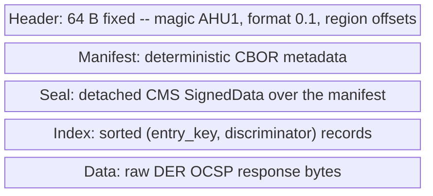
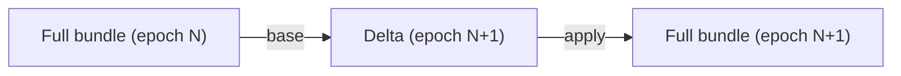
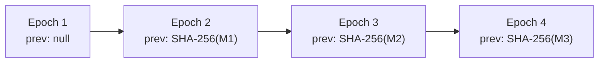

# ahu Bundle Format

An **ahu** bundle is a self-describing container that packages pre-signed
OCSP responses for efficient, zero-copy serving. The name follows Hawaiian
convention -- *ahu* means "a heap, a pile, a collection."

The normative specification is
[ahu-format-spec.md](https://github.com/czinda/hoike/blob/main/ahu-format-spec.md)
in the hoike repository. This page summarizes it; where the two disagree,
the spec wins. The 0.1 wire profile is frozen as implemented, with
independently generated golden vectors under `testdata/wire-profile-0.1/`
in the repository (a minimal full bundle and a dual-algorithm bundle).

## Container layout

Every ahu bundle follows a fixed layout with five regions:

```
+================================+
|  Header (64 bytes, fixed)      |  Magic AHU1, format version, region offsets
+--------------------------------+
|  Manifest (deterministic CBOR) |  Structured metadata about the bundle
+--------------------------------+
|  Seal (detached CMS)           |  SignedData over the manifest octets
+--------------------------------+
|  Index (sorted 48-byte recs)   |  entry_key -> (offset, length) into data region
+--------------------------------+
|  Data (DER responses)          |  Raw OCSP response bytes, directly servable
+================================+
```



Sections are contiguous and in this order. The header carries the offset
and length of each subsequent section, so a reader performs one small read
before it knows the whole layout.

### File header

The first 64 bytes are fixed. All multi-byte integers are big-endian:

| Offset | Length | Contents |
|--------|--------|----------|
| 0 | 4 | Magic `AHU1` (0x41 0x48 0x55 0x31) |
| 4 | 2 | `format_major` = 0 |
| 6 | 2 | `format_minor` = 1 |
| 8 | 8 | `manifest_offset` |
| 16 | 4 | `manifest_length` |
| 20 | 8 | `seal_offset` |
| 28 | 4 | `seal_length` |
| 32 | 8 | `index_offset` |
| 40 | 8 | `index_length` |
| 48 | 8 | `data_offset` |
| 56 | 8 | `data_length` |

A reader rejects a file whose magic does not match and a `format_major` it
does not implement; an unknown `format_minor` is tolerated (minor versions
are additive only). Header fields are not directly covered by the seal --
they are validated indirectly, because the manifest carries digests of the
index and data sections, so a tampered offset either fails a digest check
or points outside the file.

### Version layers

Three independent version identifiers are in play, and none may be
inferred from another:

| Layer | Where | Value in this profile | Advances when |
|-------|-------|-----------------------|---------------|
| File format | header `format_major`.`format_minor` | 0.1 | Container layout changes |
| Manifest schema | manifest `format_version` | 1 | CBOR manifest schema changes |
| Implementation | software package version | 0.2 | Software releases |

A bundle emitted by implementation 0.2 carries header 0.1 and manifest
`format_version` 1. An incompatible change requires a new explicit version,
never a silent reinterpretation of existing bytes.

### Manifest (CBOR)

The manifest is deterministic CBOR per RFC 8949 §4.2 (definite lengths,
canonical map ordering, shortest-form integers), so the manifest bytes can
be re-derived and digested reproducibly. Top-level fields:

| Field | CBOR type | Description |
|-------|-----------|-------------|
| `format_version` | unsigned int | Manifest schema version (1 in this profile) |
| `bundle_id` | byte string (16) | Bundle identity (UUIDv7 recommended) |
| `producer_id` | text string | Stable producer identifier (e.g., `"hoike-sign/0.2.0"`) |
| `created_at` | unsigned int | Creation time (epoch seconds, UTC) |
| `bundle_type` | unsigned int | 0 = full, 1 = delta |
| `ca_scopes` | array | One entry per issuing CA covered (see below) |
| `window` | map | `produced_at`, `this_update_min`, `next_update_min`, `next_update_max` (epoch seconds) |
| `integrity` | map | `index_digest` and `data_digest` -- SHA-256 over the index and data sections |
| `continuity` | map | `prev_manifest_digest`, `base_manifest_digest` (deltas), `chain_length` |
| `shard` | map (optional) | Shard index, count, and sharding function |
| `compression` | map (optional) | Algorithm (0 = none, 1 = zstd) and optional dictionary digest |

Each `ca_scopes` entry carries the CertID hash algorithm,
`issuerNameHash`, `issuerKeyHash`, the per-CA `epoch` (monotonic for
producer and CA), the responder ID, an optional responder certificate
chain, the response signature algorithm, and the `completeness` value
(0 = partial, 1 = authoritative-complete). `completeness` is the field
that determines behavior on a lookup miss: an authoritative-complete scope
asserts that every unexpired, non-revoked certificate issued by the CA is
represented, while a partial scope describes coverage only.

`window.next_update_min` lets a serving node decide at load time whether a
bundle is already worthless, without walking every entry.

### Seal (CMS)

The seal is a **detached CMS `SignedData`** (RFC 5652) over the manifest
octets exactly as they appear in the file. The frozen 0.1 profile:

- `encapContentInfo.eContentType` is `id-data`; the content is detached
  and the reader supplies the manifest octets out of band
- Exactly one `SignerInfo`, with SHA-256 as the digest algorithm
- Exactly one `content-type` signed attribute (`id-data`) and exactly one
  `message-digest` signed attribute (SHA-256 over the manifest octets);
  the signature is computed over the DER encoding of the signed
  attributes per RFC 5652 §5.4
- The seal certificate is carried in `certificates`

No ahu-specific content OID is allocated: an earlier draft of this format
used an `id-ct-ahuManifest` OID, which was never allocated, and the 0.1
profile drops it -- the manifest is authenticated as ordinary CMS data.
The manifest's `integrity` digests cover the index and data sections, so
the seal binds the whole bundle transitively. The seal key must be
distinct from any OCSP response signing key. See
[Seal Trust Policy](../operator/seal-trust.md) for the full admission
rules.

For verification, `ahu verify` (see [ahu CLI](../reference/ahu-cli.md))
requires an explicit mode: `--config` authenticates the seal against the
configured seal trust, or `--structure-only` checks structure and digests
without authenticity. A chain carried inside the bundle is never
sufficient on its own.

### Index

The index is a packed array of fixed-width 48-byte records, one per OCSP
response entry. All integers are big-endian:

| Field | Size | Description |
|-------|------|-------------|
| `entry_key` | 32 bytes | SHA-256 of the DER-encoded CertID |
| `data_offset` | 8 bytes | Byte offset into the data region |
| `data_length` | 4 bytes | Length of the response in the data region |
| `flags` | 2 bytes | Bit flags: `MULTI=0x01`, `ALIAS=0x02`, `TOMBSTONE=0x04`; bits 3-15 reserved |
| `discriminator` | 2 bytes | Algorithm variant, at bytes 46-47 (see below) |

**Total record size: 48 bytes.**

Records are sorted ascending by the pair `(entry_key, discriminator)` --
byte comparison on the key, numeric on the discriminator -- enabling
**O(log n) binary search** with no deserialization and no allocation on
the hot path. For a bundle with 10 million entries, a lookup requires at
most 24 comparisons (ceil(log2(10^7))). A duplicate
`(entry_key, discriminator)` pair must not appear: a reader that
encounters one rejects the bundle, as it must for any non-ascending pair
order.

#### Algorithm discriminators

The `discriminator` field distinguishes signature-algorithm variants of
the same certificate. Single-algorithm bundles use 0 for every record:

| Value | Meaning |
|-------|---------|
| 0 | Classical variant (e.g., ECDSA) |
| 2 | ML-DSA-44 variant |
| 3 | ML-DSA-65 variant |
| 4 | ML-DSA-87 variant |
| 1 | Unassigned in this profile |

Equal `entry_key` with ascending discriminators is the dual-algorithm
encoding: the same certificate addressed by two signature algorithms, one
payload each. `binary_search_preferred` resolves the best match for the
client's algorithm preference list (RFC 6960 §4.4.7.1).

Dual-CertID responses and dual-algorithm records are independent
dimensions. A dual-CertID pair shares one payload under two entry keys
(both records set `ALIAS`) and carries the same discriminator on both; a
dual-algorithm pair shares one entry key with different discriminators and
different payloads.

### Data region

The data region contains raw DER-encoded OCSP responses packed
contiguously. Each response is a complete `OCSPResponse` (RFC 6960) that
can be written directly to the HTTP response body with no transformation.

This is the key to hoike's serving performance: a serving node loads the
bundle, binary-searches the index for the entry key, and writes the data
region slice directly to the socket. No deserialization, no re-encoding,
no allocation.

If `compression.algorithm` is `zstd`, each payload is independently
compressed so a single entry can be decompressed without touching its
neighbors, and `data_length` is the stored length. The serving profile
below restricts what a responder will actually admit.

## Delta bundles

A delta bundle contains only the entries that were added, replaced, or
removed since its base. `bundle_type` is 1 and the manifest's continuity
section carries `base_manifest_digest`, naming the manifest of the full
bundle the delta applies against.

### Delta structure



A delta bundle uses the same container format but with two differences:

1. The manifest includes `base_manifest_digest` pointing to the base
   bundle's manifest
2. The index contains only changed entries (additions, updates, removals)

Removal entries set the `TOMBSTONE` flag with a `data_length` of `0` to
indicate that the entry should be deleted when applying the delta.
`chain_length` counts generations since the last full bundle.

### Serving profile

The format can represent deltas, compression, sharding, and tombstones --
what a given responder will *serve* is a narrower profile, and the two
must not be conflated. The reference responder (`hoike`) admits only
**full, uncompressed bundles**: `bundle_type = 0`, no compression, no
`TOMBSTONE` records, no base reference, `chain_length = 0`. Admission
rejects every other profile before any durable state changes, and a valid
CMS seal does not widen the profile -- an authenticated delta is
inspectable but not installable.

Delta bundles are consumed offline: materialize them into a full,
uncompressed bundle with `ahu apply` and install that. Materialization is
not a history reset -- the output carries `prev_manifest_digest` naming
its last input, so a resealed full output must still satisfy predecessor
continuity against the actual destination.

### Loading rules

When a serving node receives a new generation:

1. If the bundle is a full bundle, replace the current working set
2. If the bundle is a delta, verify that `base_manifest_digest` matches a
   bundle already loaded, then merge:
   - Add new entries
   - Replace updated entries
   - Remove entries marked with `TOMBSTONE`
3. Reject any bundle with an epoch not greater than the recorded
   high-water mark (anti-rollback)

## Anti-rollback epoch chain

Each generation's manifest contains a `prev_manifest_digest` -- the
SHA-256 of the previous generation's manifest bytes. This creates a hash
chain:



A serving node that has verified epoch N can verify that epoch N+1 is a
legitimate successor by checking:

1. `epoch(N+1) > epoch(N)` -- monotonic advance. An epoch *equal* to the
   high-water mark has one legitimate meaning -- reloading the identical
   generation after a restart -- and is accepted only if the manifest
   digest matches the digest recorded for that generation. An equal epoch
   with a different manifest digest is a fork or rollback attempt and is
   rejected.
2. `prev_manifest_digest(N+1) == SHA-256(manifest(N))` -- chain
   continuity
3. The seal on epoch N+1 is valid

This prevents an attacker from substituting an older bundle (rollback) or
a bundle from a different signer lineage (fork). High-water marks must be
persisted across restarts -- a node that forgets them has no rollback
protection at all, which is why state initialization is explicit
(`hoike init-state`) and never silently reset.

## Memory mapping and zero-copy access

The ahu format is designed for `mmap(2)`:

```
                   Process virtual memory
                   +======================+
                   |      ahu file         |
    mmap'd region  |  +-----------------+  |
                   |  | magic + header  |  |  (parsed once at load)
                   |  +-----------------+  |
                   |  | manifest (CBOR) |  |  (parsed once at load)
                   |  +-----------------+  |
                   |  | seal            |  |  (verified once at load)
                   |  +-----------------+  |
                   |  | index           |  |  <-- binary search target
                   |  +-----------------+  |
                   |  | data            |  |  <-- response bytes served directly
                   |  +-----------------+  |
                   +======================+
```

Fixed-width sorted records mean a reader can binary-search a mapped region
with no deserialization and no allocation, and the `ahu` crate exposes
this through `MmapBundle`. The reference serving path currently loads
bundles into memory and binary-searches the loaded index; the layout keeps
the mmap option available to serving nodes without a format change.

## File sizes

Bundle size scales linearly with entry count and response size (48 bytes
of index per entry):

| Entries | Avg response size | Index size | Data size | Total |
|---------|-------------------|------------|-----------|-------|
| 1,000 | 500 B | 47 KB | 488 KB | ~550 KB |
| 100,000 | 500 B | 4.6 MB | 47.7 MB | ~53 MB |
| 1,000,000 | 500 B | 46 MB | 477 MB | ~530 MB |
| 10,000,000 | 500 B | 458 MB | 4.7 GB | ~5.2 GB |

For post-quantum signatures (ML-DSA-87), response sizes are roughly 10x
larger. See the [Post-Quantum Readiness](../compliance/pqc.md) page for
detailed sizing.
