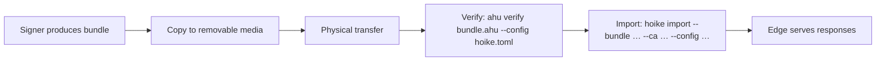

# Air-Gap Deployments

hoike supports air-gapped (enclave) deployments where there is no network connectivity between the signer and edge nodes. Bundles are transferred via removable media, and the edge serves responses using byte-identical code — there is no special air-gap binary.

## When to Use Air-Gap Mode

Air-gap deployments are appropriate for:

- **Classified networks** where no data path exists between the signing environment and the serving environment
- **High-security enclaves** with strict network segmentation requirements
- **Compliance regimes** that mandate physical separation of key material from internet-facing infrastructure
- **Disaster recovery** environments where gossip infrastructure is unavailable

## Configuration

Air-gap mode is simply an edge with gossip disabled:

```toml
[server]
mode   = "edge"
listen = "0.0.0.0:2560"

[storage]
bundle_dir = "/var/lib/hoike/bundles"
state_db   = "/var/lib/hoike/state"

[gossip]
enabled = false

[[ca]]
label          = "enterprise-issuing-01"
certid_compat  = "dual"
nonce_policy   = "ignore"
```

Everything else is standard edge configuration — the same `[[ca]]` sections, the same `[storage]` layout, the same serving behavior.

## Bundle Import Workflow



### Step by Step

1. **Signer produces bundles** on the signing network as usual (via `batch_interval` scheduling).

2. **Copy bundles to removable media.** USB drives, optical discs, or any physically transferable storage.

3. **Physically transfer the media** to the air-gapped network following your site's security procedures.

4. **Verify bundles before importing.** On the air-gapped edge (or a verification workstation on the air-gapped network), authenticating under the edge's configured seal trust:

   ```bash
   ahu verify /media/usb/bundles/enterprise.ahu --config /etc/hoike/hoike.toml
   ```

   A bare `ahu verify FILE` invocation fails — verification is always an explicit mode. See [Verification with `ahu verify`](#verification-with-ahu-verify).

5. **Initialize state once, before the first import** (and before the first `serve`):

   ```bash
   hoike init-state --config /etc/hoike/hoike.toml
   ```

6. **Install the verified bundle:**

   ```bash
   hoike import --bundle /media/usb/bundles/enterprise.ahu \
                 --ca enterprise-issuing-01 \
                 --config /etc/hoike/hoike.toml
   ```

   Import is an **offline, authenticated, recoverable installation**, not a staging copy:

   - **Authenticated.** The bundle is verified under the configured CMS seal trust and scope authorizations, even if `allow_unauthenticated_bundles` is set for demo serving. Rollback and fork checks run against committed state.
   - **Single-read source.** The bundle is read exactly once before installation, so everything published comes from the checked bytes even if the source media changes afterwards.
   - **Recoverable.** The immutable generation snapshot is written and fsynced first, the state descriptor is committed atomically (the installation commit point), and only then is the configured bundle path published. A failure before the commit preserves the previous generation byte-for-byte; a failure after it recovers from the committed snapshot, and retrying the identical import repairs the published path.
   - **Scoped.** `--ca` selects the destination through the configuration — the CA's `bundle_file` when set, otherwise `bundle_dir/<label>.ahu`. Unknown or unsafe labels are rejected.
   - **Offline.** Import fails while a server holds the writer lock on the state directory — stop `hoike serve` first. There is no `--force`; import refuses an active writer by design. Completion instructs you to start the server.

   `hoike check` remains read-only throughout: it validates configuration and bundle trust without installing anything or changing state.

## Verification with `ahu verify`

Always verify bundles before importing. `ahu verify` requires an explicit mode:

| Invocation | What it validates |
|------------|-------------------|
| `ahu verify FILE --config PATH` | **Authenticated.** Structure, digests, and the CMS seal under the configured trust and scope-authorization policy. Missing trust, corrupt seals, expired seal certificates, and unauthorized scopes fail. |
| `ahu verify FILE --structure-only` | **Structure only.** Container structure and content digests; prints `Structure valid; authenticity not checked.` Never a basis for import decisions outside local demos. |
| `ahu verify FILE --entries --config PATH` | As `--config`, plus checks each embedded OCSP response signature via the embedded responder keys. |

```bash
$ ahu verify bundle-epoch-42.ahu --config /etc/hoike/hoike.toml
✓ CMS seal valid and trusted (signer: CN=OCSP Signer, O=Example Corp)
✓ Epoch 42 — chain consistent
✓ Manifest integrity OK (sha-256)
```

If verification fails, do **not** import the bundle. Investigate the cause — possible media corruption, tampering, or a stale bundle from the wrong signer.

## Byte-Identical Serving Code

The edge binary is exactly the same regardless of how bundles arrive:

- Via gossip pull from the signer
- Via manual file copy (e.g., `scp`)
- Via `hoike import` from removable media

There is no compile-time flag, no special air-gap mode in the binary, and no runtime code-path divergence. The only difference is configuration: `gossip.enabled = false`.

This means security auditors can verify a single binary for all deployment models.

## Operational Considerations

### Plan Import Frequency Around Validity Windows

Bundles have a `validity_secs` window (default 86400). You must import fresh bundles **before the current bundle expires**, or the edge will start returning stale responses that relying parties may reject.

The **signer outage budget** — the maximum time you can go without producing a new bundle — is:

```
outage_budget = validity_secs − batch_interval
```

With defaults (86400 s validity, 3600 s batch interval), you have a 23-hour window. For air-gap, plan your physical transfer cadence well within this window. A common approach: transfer bundles daily with a 24h validity, giving you a full day of margin.

### state_db Must Persist

The `state_db` directory stores epoch high-water marks, manifest-digest records, and committed bundle snapshots. It **must persist** across restarts, even in air-gap mode. State is strict: a missing or corrupt state directory is a **recovery error**, never a silent fresh timeline — `hoike serve` refuses to start without initialized state, and `hoike import` requires state that has already been initialized with `hoike init-state`.

If `state_db` is lost:

- Restore it from backup — marks, snapshots, and lock file **as one unit**; do not re-initialize over recovery material
- See [Anti-Rollback Protection](./anti-rollback.md) for the full state and exclusive-writer semantics

### Only Full, Uncompressed Bundles Are Served

The serving profile admits **full, uncompressed bundles only**. Delta bundles, delta chains, tombstones, and compression are ahu format features that the serving path rejects at admission — an orphan delta never becomes durable state. If your signing side produces deltas, materialize them into a full bundle first:

```sh
ahu apply base.ahu delta.ahu -o merged.ahu \
  --seal-key /etc/hoike/keys/seal.p8 \
  --seal-cert /etc/hoike/keys/seal.crt \
  --input-signer-pin /etc/hoike/trust/seal-signer-2026.crt
```

`ahu apply` produces an **unsigned** intermediate by default; sealing it requires the seal key pair and authenticated inputs (see [Seal Trust Policy](./seal-trust.md)). For air-gap transfers, the simplest posture remains transferring full bundles only — the size overhead buys operational simplicity.

### No Automatic Urgent Revocation

In gossip-connected deployments, urgent revocations trigger immediate off-cycle bundle production and gossip notification. In air-gap mode, there is no notification channel. If an urgent revocation occurs:

1. The signer produces the off-cycle bundle as usual
2. You must physically transfer it to the air-gapped network
3. The edge cannot serve the updated revocation status until the import completes

Plan your incident response procedures to account for the physical transfer latency.
