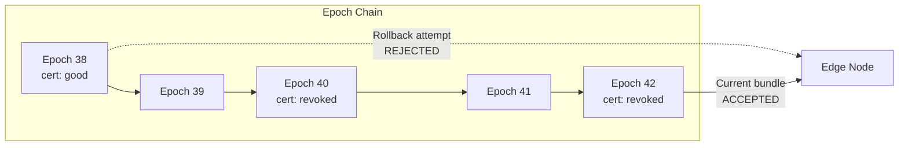

# Anti-Rollback Protection

Anti-rollback protection prevents an attacker or misconfiguration from replaying an older bundle to restore previously-revoked certificates to "good" status. This is a critical security property — without it, an adversary with access to historical bundles could silently undo revocations.

## The Threat

Consider a certificate revoked in epoch 40. If an attacker can replace the current bundle (epoch 42) with a bundle from epoch 38 (before the revocation), the edge would start serving "good" responses for the revoked certificate. Anti-rollback makes this impossible.



## Epoch Chain

Each bundle carries a monotonically increasing **epoch number**, scoped per CA. The signer increments the epoch on every bundle production — whether scheduled or triggered by an urgent revocation.

The epoch chain forms a simple sequence:

```
epoch N → epoch N+1 → epoch N+2 → ...
```

Every bundle's epoch is recorded in its CBOR manifest and covered by the CMS seal, so it cannot be altered without breaking the signature.

## High-Water Marks

The `state_db` directory persists, for each CA, the **highest epoch seen** together with the **manifest digest** of the generation that produced it. On every bundle load, the edge enforces:

```
new_epoch > stored_high_water_mark
```

If the new bundle's epoch is less than the stored high-water mark, the bundle is rejected as a rollback.

### Identical-Generation Restart Exception

An **equal** epoch is accepted only when the **manifest digest is identical** to the recorded one. This is the safe-restart case: a node that re-loads the same bundle it is already serving — after a crash, container recreation, or bundle re-import — keeps serving without a spurious fork alarm. An equal epoch with a *different* manifest digest is a fork (see below).

### Example

| Event | Stored HWM | Incoming Epoch | Result |
|-------|-----------|----------------|--------|
| Load epoch 40 | 39 | 40 | **Accepted** — HWM updated to 40 |
| Load epoch 41 | 40 | 41 | **Accepted** — HWM updated to 41 |
| Load epoch 38 | 41 | 38 | **Rejected** — rollback detected |
| Load epoch 41 (same manifest digest) | 41 | 41 | **Accepted** — identical generation, safe restart |
| Load epoch 41 (different manifest digest) | 41 | 41 | **Rejected** — fork detected |

## Fork Detection

If two bundles arrive with the **same epoch but different manifest digests**, this is a **fork** — it means two signers produced bundles independently for the same CA, or a single signer's state was cloned.

Fork detection catches:

- **Misconfigured duplicate signers**: Two signer instances both believe they are authoritative for the same CA
- **State cloning**: A signer's state directory was copied, producing a second lineage
- **Compromise**: An attacker with the signing key producing alternative bundles

Fork is always a critical security event requiring immediate investigation.

## Rejection Reasons

Bundle load failures are categorized into six reasons, matching the `bundle_load_failed` audit event (see [Audit Logging](../security/audit-logging.md)):

| Reason | Condition | Severity |
|--------|-----------|----------|
| **rollback** | New epoch < stored high-water mark | **Critical** — possible replay attack |
| **fork** | Same epoch, different manifest digest | **Critical** — duplicate signer or compromise |
| **bundle** | Malformed container, seal verification failure, or a seal from an unauthorized signer | **High** — corruption, tampering, or wrong trust policy |
| **state** | The anti-rollback state store could not be read or persisted | **High** — recovery required |
| **io** | Filesystem error | **High** — corruption or storage failure |
| **other** | Anything else; the accompanying `error` field carries detail | Varies |

The first two (`rollback` and `fork`) are security events. `bundle` typically indicates a bad or untrusted bundle (wrong signer, tampering in transit, or a trust-policy mismatch), while `state`, `io`, and `other` point at the node itself rather than the bundle. See [Seal Trust Policy](./seal-trust.md) for bundle admission rules.

## state_db Persistence

The `state_db` directory is where epoch high-water marks and manifest-digest records live, together with the immutable committed bundle snapshots the marks refer to. It **must persist** across process restarts, container recreations, and node replacements.

```toml
[storage]
state_db = "/var/lib/hoike/state"
```

State is **operator-acknowledged, not a cache**. Opening state is strict:

- **Missing state is a recovery error**, never a silent fresh timeline. A node that silently forgot its high-water marks would accept an older epoch, so `hoike serve` refuses to start and points you at explicit initialization or recovery instead.
- **Corrupt state is a recovery error.** Committed state is validated on open — high-water marks must be paired with manifest-digest records, and every committed snapshot must exist, hash to the digest in its filename, and carry marks at or above its epoch. Valid legacy JSON remains readable.
- **`hoike init-state --config PATH`** bootstraps a fresh state directory explicitly, once. It refuses an existing state file and refuses a directory containing recovery material; there is no `--force`. `serve` never creates state implicitly.
- **Recovery means restoring, not resetting.** Do not delete high-water marks to recover from failures and do not re-initialize over recovery material — restore marks and snapshots together (see below).

This is why `state_db` is a separate path from `bundle_dir`:

- `bundle_dir` can be ephemeral — bundles are replaceable (re-pull from signer or re-import)
- `state_db` is **persistent state** — mount it on durable storage, back it up, and include it in disaster recovery plans

In containerized environments, `state_db` should be on a persistent volume, not an ephemeral container filesystem.

## Exclusive Writer

One writer process per state directory, enforced in addition to being documented. `hoike serve`, `hoike init-state`, and offline `hoike import` hold an OS-level exclusive `flock` on a `.writer.lock` file inside the state directory for their **full process lifetime**; a second writer is rejected immediately. The lock file is never unlinked.

Operational consequences:

- **Stop the previous writer before starting a new one** against the same state directory — including before running `hoike import`, which fails while a server holds the lock.
- Read-only paths (`hoike check`, `ahu verify`) do not take the lock and can run alongside a writer.
- This enforces the single-host writer rule. It is not distributed signer fencing — one active signer per CA across a fleet is still an operational invariant you must maintain.

Back up and restore the state directory — marks, snapshots, and lock file — **as one unit**. Old binaries are not qualified to read the new snapshot state.

## Critical Alerts

Two metrics form the foundation of hoike operational monitoring:

### `bundle_next_update_seconds`

**What:** Gauge showing seconds until the current bundle's `nextUpdate` timestamp.

**Why it matters:** When this reaches zero, the edge is serving responses past their validity window. Relying parties that check freshness will reject them.

**Alert thresholds:**

| Level | Threshold | Meaning |
|-------|-----------|---------|
| Warning | < 4h remaining | Signer may be down; investigate |
| Critical | < 1h remaining | Responses will expire soon; immediate action required |

The warning threshold should be comfortably above `batch_interval` (default 3600 s). With a 24h validity and 1h batch interval, alerting at 4h gives you three missed batches before going critical.

### `bundle_load_failures` (by reason)

**What:** Counter of failed bundle loads, labeled by rejection reason (`rollback`, `fork`, `bundle`, `state`, `io`, `other`).

**Why it matters:** Any non-zero increment for `rollback` or `fork` is a **critical security alert** requiring immediate investigation.

**Alert rules:**

| Reason | Alert level | Action |
|--------|-------------|--------|
| `rollback` | **Critical** | Possible replay attack. Investigate bundle distribution path immediately. |
| `fork` | **Critical** | Duplicate signer or compromise. Identify and shut down the rogue signer. |
| `bundle` | Warning | Malformed, untrusted, or tampered bundle. Verify signer configuration and seal trust policy. |
| `state` | Warning | State store could not be read or persisted. Treat as a recovery event — see [state_db Persistence](#state_db-persistence). |
| `io` | Warning | Filesystem error. Check storage health and re-transfer the bundle. |
| `other` | Warning | Inspect the accompanying `error` field. |

## Recovery Procedures

### Rollback Detected

1. **Investigate the source.** Why was an old bundle offered? Common causes:
   - Stale bundle cached in a CDN or reverse proxy
   - Misconfigured bundle distribution pipeline pointing at an old directory
   - An attacker replaying a captured bundle
2. **Fix the distribution path.** Purge stale caches, correct directory pointers.
3. **Produce a new bundle** from the authoritative signer. The new epoch will be above the high-water mark and will load successfully.

### Fork Detected

1. **Identify the duplicate signer.** Check which hosts are running in signer mode for the affected CA.
2. **Shut down the unauthorized signer.** Only one signer should be authoritative per CA at any time.
3. **Produce a new bundle** from the authoritative signer with the next epoch.
4. **Audit the fork window.** Determine whether any responses from the forked lineage were served, and whether they differed in revocation status.

### Bundle, State, or I/O Failure

1. **Check for media corruption.** Re-download or re-transfer the bundle.
2. **Verify with `ahu verify --config`** on a trusted workstation to confirm the bundle is intact and trusted at the source (`ahu verify FILE --config PATH` authenticates under the configured trust; `--structure-only` checks structure and digests only).
3. **If the source bundle also fails verification**, investigate the signer — the seal key may have changed, or the signer may be compromised.
4. **If the reason was `state`**, do not reset state. Follow the recovery procedure in [state_db Persistence](#state_db-persistence): restore marks and snapshots together from backup.
