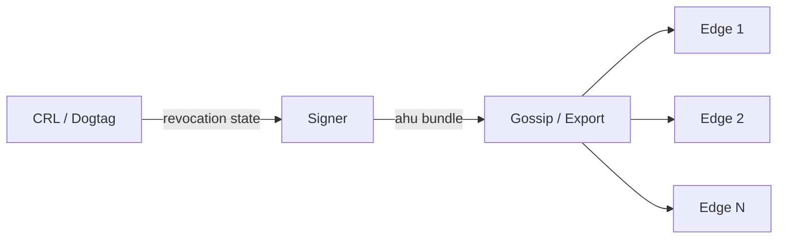

# Signer Mode

The signer is the security-critical half of hoike's split architecture. It holds private signing keys, reads revocation state from configured sources, and batch-produces **ahu bundles** — self-describing containers of pre-signed OCSP responses that edge nodes serve verbatim.



## Enabling Signer Mode

Set `mode = "signer"` in the `[server]` section:

```toml
[server]
mode   = "signer"
listen = "0.0.0.0:2560"
```

In signer mode, hoike does **not** serve OCSP responses to clients directly. Its job is to produce ahu bundles and distribute them to edge nodes (via gossip, manual copy, or scheduled fetch).

## Revocation Sources

Each `[[ca]]` section declares a revocation source that the signer polls for certificate status. See [Revocation Sources](./revocation-sources.md) for the full reference.

### CRL (implemented)

The CRL adapter reads a DER- or PEM-encoded CRL from a local path:

```toml
[[ca]]
label  = "enterprise-issuing-01"

[ca.source]
type        = "crl"
path        = "/var/lib/hoike/crls/enterprise.crl"
issuer_cert = "/etc/hoike/trust/enterprise-ca.crt"   # required
```

The signer re-reads the CRL file on every batch cycle. An external process (e.g., `cron` + `curl`) is responsible for keeping the CRL file up to date.

### Dogtag 389 DS syncrepl (requires `--features dogtag-sync`)

RFC 4533 Content Synchronization against the Dogtag 389 DS certificate repository. This is the **positive issuance source** — it enumerates every issued certificate, enabling `authoritative-complete` bundles where a miss is confirmed "never issued."

```toml
[[ca]]
label  = "dogtag-ca-01"
completeness = "authoritative-complete"

[ca.source]
type             = "dogtag-sync"
ldap_url         = "ldap://ds-iot.cert-lab.local:3389"
base_dn          = "ou=certificateRepository,ou=ca,o=pki-iot-ca-CA"
bind_dn          = "cn=Directory Manager"
bind_password_env = "HOIKE_LDAP_PASSWORD"
```

The adapter performs an initial full refresh, then uses the sync cookie for incremental updates. Directories that do not expose the RFC 4533 Sync Request control (such as stock 389 DS) fall back to one full poll per batch — see [Revocation Sources](./revocation-sources.md#full-poll-fallback). Certificate statuses are mapped: `VALID`→Good, `REVOKED`→Revoked (with reason/time), `REVOKED_EXPIRED`→Revoked, `EXPIRED`/`INVALID`→skipped.

## Batch Production

The signer produces ahu bundles on a recurring schedule controlled by per-CA timing keys. All timing values are **integer seconds**:

| Key                  | Default | Description                                                                                       |
|----------------------|---------|---------------------------------------------------------------------------------------------------|
| `batch_interval`     | `3600`  | How often (seconds) the signer produces a new bundle                                              |
| `validity_secs`      | `86400` | Response validity window (`nextUpdate` − `thisUpdate`), in seconds                                 |
| `jitter_secs`        | `7200`  | Upper bound of randomized jitter added to `nextUpdate` (thundering-herd avoidance)                |
| `max_age_fraction`   | `0.5`   | Fraction of the validity window advertised as the edge's HTTP `Cache-Control: max-age`; in `(0, 1]` |
| `archive_cutoff_secs`| `0`     | Drop entries for certificates expired more than this many seconds ago. **Only effective for dogtag-sync sources** — a CRL carries no per-certificate `notAfter` — and `hoike check` warns if you set it on a CRL-backed CA. Entries with unknown expiry are never dropped. |

```toml
[[ca]]
label           = "enterprise-issuing-01"
validity_secs   = 86400
batch_interval  = 3600
jitter_secs     = 7200

[ca.source]
type        = "crl"
path        = "/var/lib/hoike/crls/enterprise.crl"
issuer_cert = "/etc/hoike/trust/enterprise-ca.crt"
```

### Signer Outage Budget

The **outage budget** is the maximum time the signer can be offline before edge nodes begin serving expired responses:

```
outage_budget = validity_secs − batch_interval
```

With defaults: **86400 − 3600 = 82800 seconds (23 hours)**. This is the single most important number for capacity planning. If the signer goes down, edge nodes continue serving the last bundle until `nextUpdate` passes.

To increase the outage budget, increase `validity_secs` — but longer validity means revocation information takes longer to propagate. This is a fundamental trade-off.

### Jitter

The `jitter_secs` key bounds a random offset added to each response's `nextUpdate`. This prevents all responses in a bundle from expiring at exactly the same instant, which would cause a cache stampede at relying parties. Jitter is bounded by the source's own `nextUpdate` and can shorten a response's window, never extend it.

## Signing Configuration

### Signing Keys

hoike supports three key sources. The `[ca.signing_key]` table is required for signer/combined mode.

**PKCS#8 file:**
```toml
[ca.signing_key]
type = "file"
path = "/etc/hoike/ocsp-signing.key"
```

**PKCS#11 HSM** (requires `--features pkcs11`):
```toml
[ca.signing_key]
type        = "pkcs11"
module      = "/usr/lib/libCryptoki2_64.so"    # Thales Luna
token_label = "hoike-partition"
key_label   = "ocsp-signing"
pin_env     = "HOIKE_HSM_PIN"
```

Omit `pin` and `pin_env` to prompt interactively at startup (recommended for production). Documented HSM module paths: Thales Luna, Entrust nShield, Utimaco CryptoServer, FutureX Vectera, Kryoptic (testing).

**Demo key** (testing only — produces a warning):
```toml
[ca.signing_key]
type = "demo"
```

### Delegated Signing

When a delegated OCSP signing certificate is configured, it is embedded in every `BasicOCSPResponse.certs` per RFC 9919 §3.2.2. The `ResponderID` is computed from the certificate's SPKI key hash (not the CA's key).

```toml
[[ca]]
label          = "enterprise-issuing-01"
responder_cert = "/etc/hoike/ocsp-responder.pem"
```

The responder certificate must have `id-kp-OCSPSigning` EKU and be issued by the CA.

### Signature Algorithms

| Algorithm    | Type           | Notes                              |
|--------------|----------------|------------------------------------|
| `ecdsa-p256` | Classical      | Default; widely supported          |
| `ml-dsa-44`  | Post-quantum   | NIST FIPS 204, security level 2    |
| `ml-dsa-65`  | Post-quantum   | NIST FIPS 204, security level 3    |
| `ml-dsa-87`  | Post-quantum   | NIST FIPS 204, security level 5    |

```toml
[[ca]]
label   = "pqc-ready-ca"
sig_alg = "ml-dsa-65"
```

> **Note:** Post-quantum algorithms produce significantly larger signatures. Verify that your relying parties support ML-DSA before switching.

### Responder ID

The `ResponderID` in produced responses is always the key-hash (by-key) form, computed from the SubjectPublicKeyInfo of the certificate that signs the response — the delegated responder certificate when `responder_cert` is set, otherwise the CA's own key. There is no configuration key for this; configure `responder_cert` and the identifier follows.

### CertID Compatibility

The `certid_compat` field controls which hash algorithms the signer uses for CertID matching:

| Value    | Behavior                                                          |
|----------|-------------------------------------------------------------------|
| `dual`   | Index by both SHA-256 and SHA-1 hashes (default, widest compat)   |
| `sha256` | SHA-256 only (RFC 9654 compliant, modern clients)                 |
| `sha1`   | SHA-1 only (legacy clients only — not recommended)                |

```toml
certid_compat = "dual"
```

## PKCS#11 / HSM Support

PKCS#11 integration allows the signer to use hardware security modules (HSMs) for key storage and signing operations, including ML-DSA via `CKM_ML_DSA`. Configure the signing key as a PKCS#11 reference:

```toml
[ca.signing_key]
type        = "pkcs11"
module      = "/usr/lib/libCryptoki2_64.so"    # Thales Luna
token_label = "hoike-partition"
key_label   = "ocsp-signing"
pin_env     = "HOIKE_HSM_PIN"
```

Omit `pin` and `pin_env` to prompt interactively at startup (recommended for production). Tested with Kryoptic; documented paths for Thales Luna, Entrust nShield, Utimaco CryptoServer, and FutureX Vectera.

Build with HSM support:

```sh
cargo build --release --features pkcs11
```

### Live Nonce Signing from an HSM

`nonce_policy = "live"` works with PKCS#11 keys as well as ECDSA file keys. Before serving live responses, the HSM key proves ownership of the responder certificate by signing a preflight message that hoike verifies under the certificate's public key — the private key never leaves the module.

`CKR_USER_ALREADY_LOGGED_IN` on login is treated as success, because PKCS#11 permits one logged-in user per token. Batch, live, and rotation signers can therefore coexist on the same token.

Two limits remain: live nonce signing requires the configured ECDSA key (file or HSM) — ML-DSA live signing is not supported — and seal keys are always software P-256 keys, never HSM-backed.

## Dual-Algorithm Bundles

hoike can produce bundles containing both ECDSA and ML-DSA responses for the same certificates. Clients negotiate the preferred algorithm via RFC 6960 §4.4.7.1 `PreferredSignatureAlgorithms`.

```sh
hoike sign \
  --ca enterprise-ca \
  --crl ca.crl \
  --signing-key ecdsa.key \
  --sig-alg ecdsa-p256 \
  --dual-alg ml-dsa-87 \
  --pq-signing-key ml-dsa.key \
  --seal-key seal.p8 \
  --seal-cert seal.crt \
  -o dual.ahu
```

One bundle, both algorithms, no flag day. A client that prefers `ml-dsa-87` gets the ML-DSA response; all others get ECDSA. `--seal-key` and `--seal-cert` must be provided together for file-key signing (see [CMS Seal](#cms-seal)); `--demo-key` generates distinct ephemeral seal material instead.

## Key Rotation

hoike monitors OCSP signing certificate expiry and can execute a renewal command automatically.

```toml
[ca.key_rotation]
renew_before_days    = 7
check_interval_hours = 1
rotation_command     = "/usr/local/bin/renew-ocsp-cert.sh"
```

The signer checks the responder certificate at each batch interval. When the certificate is within `renew_before_days` of expiry, hoike logs a warning and runs `rotation_command`. When the certificate has expired, hoike logs an error — responses signed with an expired certificate will be rejected by clients.

## CMS Seal

Each ahu bundle is sealed with a CMS `SignedData` signature (RFC 5652) that binds the manifest, index, and data regions. The seal key must be distinct from the OCSP signing key.

Production signing keys (`type = "file"` or `type = "pkcs11"`) require a **complete `seal_key` + `seal_cert` pair per CA**. A missing pair, or exactly one of the two, is a configuration error — there is no fallback to the OCSP signing key. Demo signing (`type = "demo"`) omits both and generates a **distinct ephemeral seal pair** for that signing pass (testing only, never pinned across generations).

```toml
[[ca]]
label     = "enterprise-issuing-01"
seal_key  = "/etc/hoike/keys/seal.p8"
seal_cert = "/etc/hoike/keys/seal.crt"   # PEM or DER
```

### Key separation

The seal key must be **cryptographically distinct** from the CA's OCSP signing key. ECDSA signers prove this at every signing pass by signing the domain-separated message `hoike:seal-ocsp-key-separation:v1`, which hoike verifies under the seal public key. The same key material reached via different paths or symlinks is rejected — the proof is over the key, not the file name. A failed proof fails the signing pass before anything is produced or published.

### Seal preflight

The `seal_key`/`seal_cert` pair is proven with a **real CMS preflight seal on every signing pass**, so a mismatched or expired replacement fails closed before publication. Seal certificates are accepted in PEM or DER; both are normalized on load.

When seal trust (`seal_trust_anchors`, `seal_signer_pins`, or `seal_authorizations`) is configured in `[storage]`, bundles without a valid seal are rejected at admission. See [Seal Trust Policy](./seal-trust.md).

## Urgent Revocation

When `urgent_revocation = true` (the default), the signer polls the revocation source for newly detected revocations every **300 seconds** and, upon detecting one, produces an **off-cycle bundle** immediately — without waiting for the next scheduled `batch_interval`. The off-cycle run emits a `signer_generation` audit event with `trigger = "urgent"`.

```toml
[[ca]]
urgent_revocation = true   # default
```

This is critical for high-security deployments where the standard batch interval creates an unacceptable revocation propagation delay. The off-cycle bundle is distributed to edges through the normal gossip or pull mechanism.

Set `urgent_revocation = false` only if your revocation SLA is satisfied by the regular batch interval.

## Completeness

The `completeness` field declares the signer's knowledge of the CA's revocation state:

| Value                      | Meaning                                                       |
|----------------------------|---------------------------------------------------------------|
| `authoritative-complete`   | Signer has full revocation knowledge (direct CA access)       |
| `partial`                  | CRL-only; may miss certificates not yet on the CRL            |

```toml
completeness = "authoritative-complete"
```

When set to `authoritative-complete`, a serial with no stored entry is provably never issued. On the live path, when the request carries a nonce, the signer signs a fresh RFC 6960 `certStatus: unknown` response for it on demand — a signed, checkable "never issued" answer. Keyless edges with `nonce_policy = "forward"` forward such requests to the scope's `forward_to` signer, which synthesizes the signed unknown. Downstream tooling can rely on this because the bundle's manifest asserts the population is complete, and the assertion is only stamped on a successful refresh.

When set to `partial`, a serial with no entry in the bundle is answered with the unsigned `unauthorized` error at serve time: the signer cannot assert `unknown` for a serial it cannot see, and it will never fabricate a `good`. The signed unknown is exclusive to `authoritative-complete` scopes.

## Full Signer Example

```toml
[server]
mode   = "signer"
listen = "127.0.0.1:2560"

[storage]
bundle_dir = "/var/lib/hoike/bundles"
state_db   = "/var/lib/hoike/state"

[gossip]
enabled      = true
bind         = "0.0.0.0:7946"
identity_key = "/etc/hoike/gossip.key"
node_name    = "signer-01"

[[ca]]
label               = "enterprise-issuing-01"
sig_alg             = "ecdsa-p256"
certid_compat       = "dual"
nonce_policy        = "ignore"
completeness        = "partial"        # CRL sources cannot claim authoritative-complete
validity_secs       = 86400
batch_interval      = 3600
jitter_secs         = 7200
max_age_fraction    = 0.5
urgent_revocation   = true
responder_cert      = "/etc/hoike/ocsp-responder.pem"
seal_key            = "/etc/hoike/keys/seal.p8"    # required pair for file/pkcs11 keys
seal_cert           = "/etc/hoike/keys/seal.crt"
issuer_name_der_b64 = "MEUx…"   # DER of the issuer DN, base64
issuer_key_bytes_b64 = "A0IA…"  # issuer public-key bytes, base64

[ca.source]
type        = "crl"
path        = "/var/lib/hoike/crls/enterprise.crl"
issuer_cert = "/etc/hoike/trust/enterprise-ca.crt"

[ca.signing_key]
type = "file"
path = "/etc/hoike/ocsp-signing.key"
```

## Operational Considerations

- **Key protection:** The signer is the only component that touches private keys. Run it on a hardened host with restricted network access. In high-security deployments, consider an air-gapped signer that exports bundles to removable media (see [Air-Gap Deployments](./air-gap.md)).

- **Monitoring:** Watch `bundle_production_seconds` (histogram) and `bundle_next_update_seconds` (gauge) metrics. Alert when `bundle_next_update_seconds` drops below your outage budget threshold.

- **Backup:** The `state_db` directory contains epoch high-water marks used for [anti-rollback protection](./anti-rollback.md). Back it up — but never restore an old snapshot, as this could allow rollback attacks.

- **Scaling:** The signer does not need horizontal scaling — bundle production is inherently serial per CA. For multiple CAs, configure multiple `[[ca]]` sections in a single signer (see [Multi-CA Routing](./multi-ca.md)).
